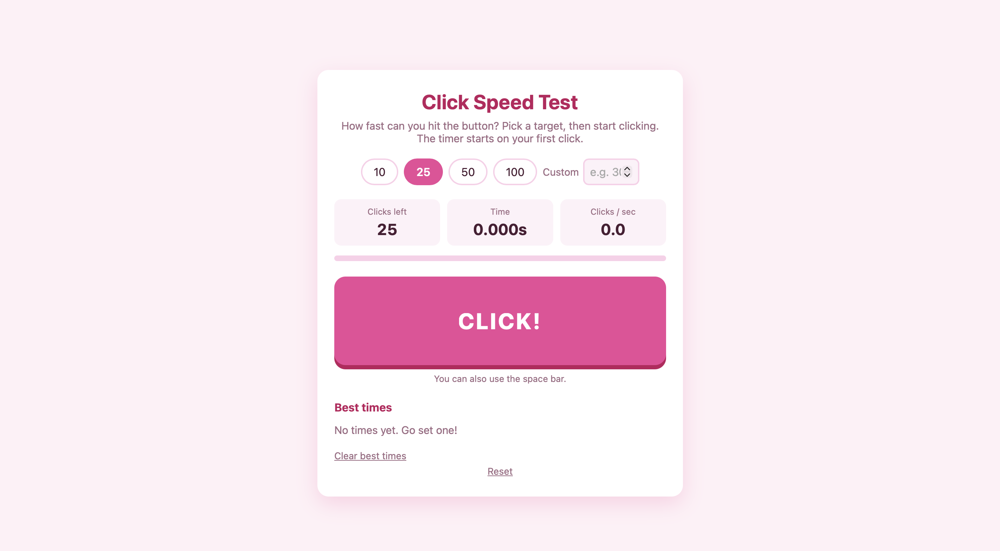
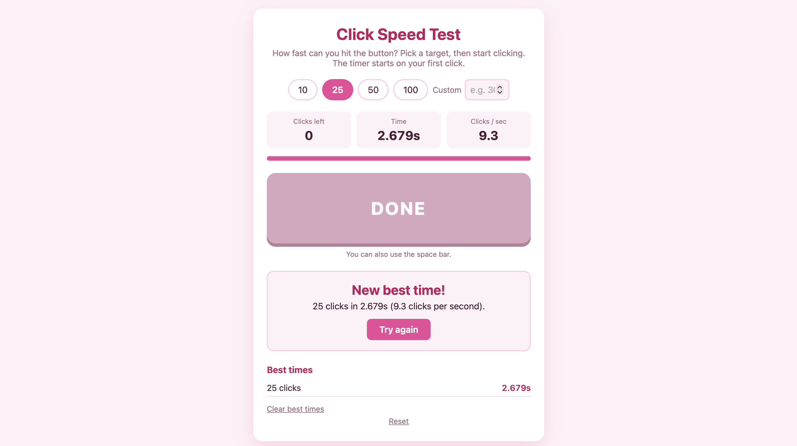

# Click — Click Speed Test

A browser game that times how fast you can click a button a set number of times, built with HTML, CSS and JavaScript.

## Overview

You pick a target number of clicks, then hit the button as fast as you can. The timer starts on your first click and stops on your last one, and you get your total time and clicks per second. Your best time for each target is saved in your browser so you can try to beat it.

## Features

- Choose 10, 25, 50 or 100 clicks, or enter your own custom number (up to 1000)
- Timer starts on the first click, not when the page loads
- Live display of clicks left, time and clicks per second
- Progress bar that fills as you click
- Best times saved for each target using localStorage
- Works with mouse, touch screens and the space bar
- Responsive layout that works on phones and desktops

## Screenshots

**Main Game Window**


Main game window with the target selection, live stats, progress bar and the click button.


**Results Screen**


Results shown after finishing a round, with the total time, clicks per second and the saved best times.

## Tech Stack

- **Language:** JavaScript
- **Markup:** HTML5
- **Styling:** CSS3
- **Storage:** localStorage (browser)

## Getting Started

1. Clone the repository:
```
   git clone https://github.com/kayla014/click.git
```
2. Open the project folder:
```
   cd click
```
3. Open `index.html` in your browser. There is nothing to install.

## How It Works

The game listens for clicks on the main button and counts them until the chosen target is reached. The timer starts on the first click and uses `performance.now()` for accurate timing, then stops when the last click is registered. The result is compared against the saved best time for that target and stored in localStorage if it is a new record.

## Notes

This project was built as a small personal project to practise JavaScript, DOM events, timers and browser storage.

## Developer

**Kayla Abdul Ganie**

BSc Information Technology – Software Engineering

Eduvos

GitHub: [@kayla014](https://github.com/kayla014)
